# Sphere (Science Physics High Energy Research Environment)

**Sphere** functions as an experimental environment (a sandbox) or an advanced visual REPL. It allows to test scripts, run code on the fly, and inspect data without having to recompile large applications.

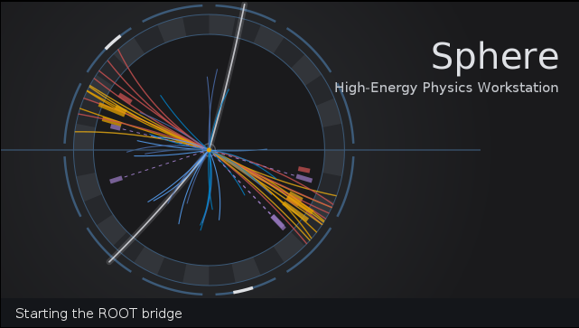

## Expanding Toward a Full HEP Simulation Pipeline
My long‑term objectives also include integrating Geant4, MG5, and Herwig, in order to extend the system into a full HEP simulation and analysis pipeline.

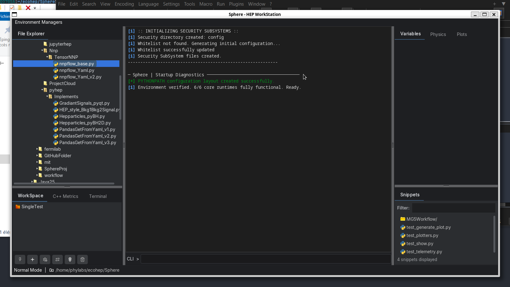
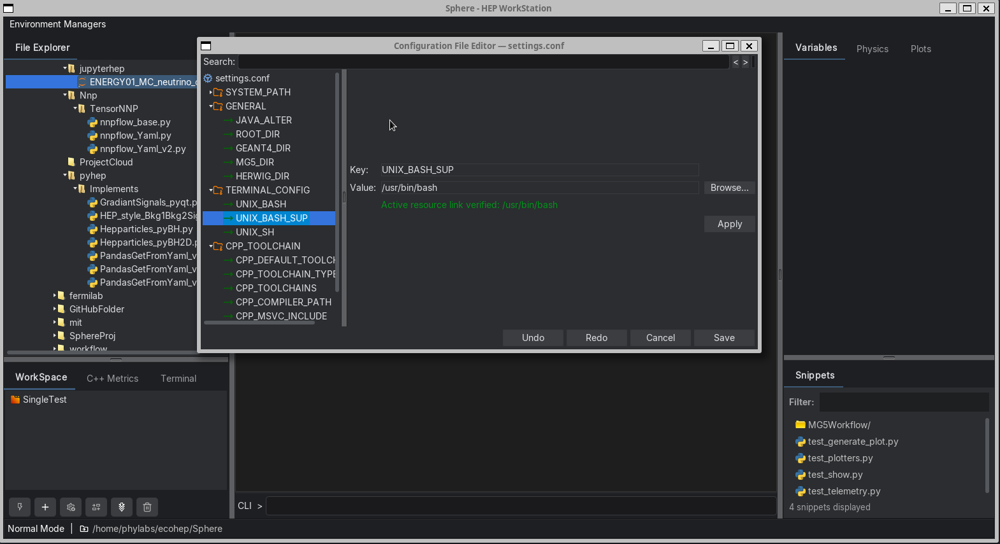
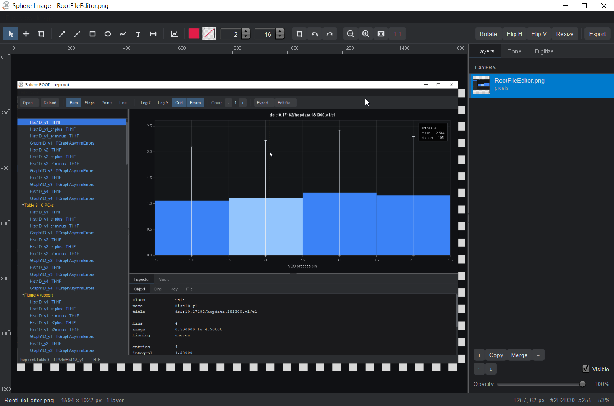

## **Why It Is a Sandbox**

### **• On‑the‑fly execution**  
The interactive CLI lets you inject and test code snippets in C++, Python, Julia in real time.

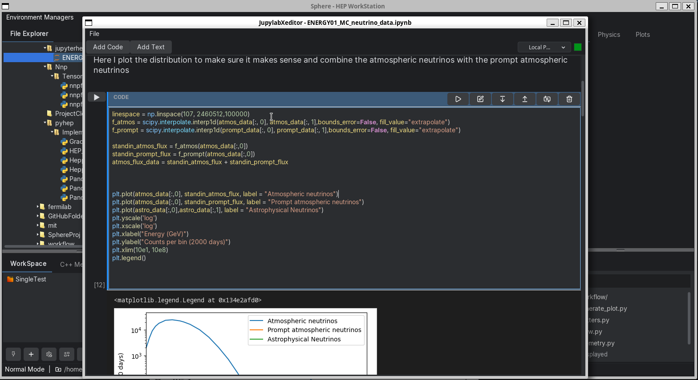
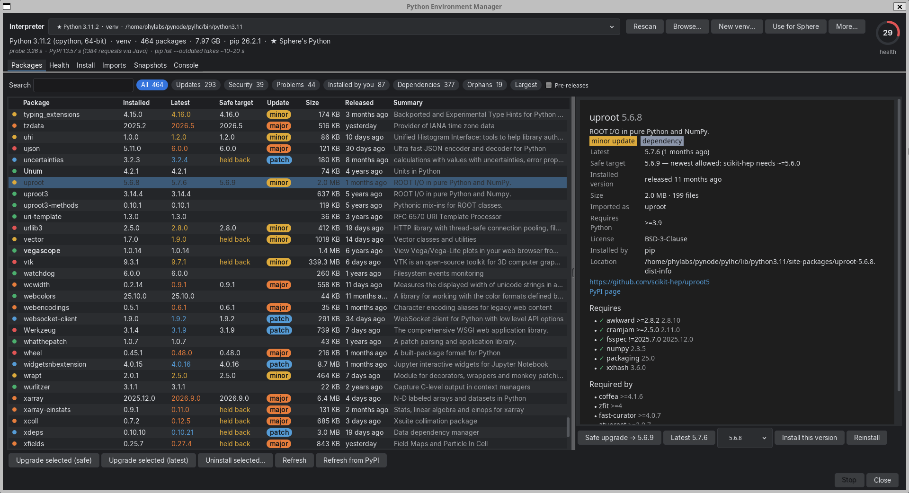
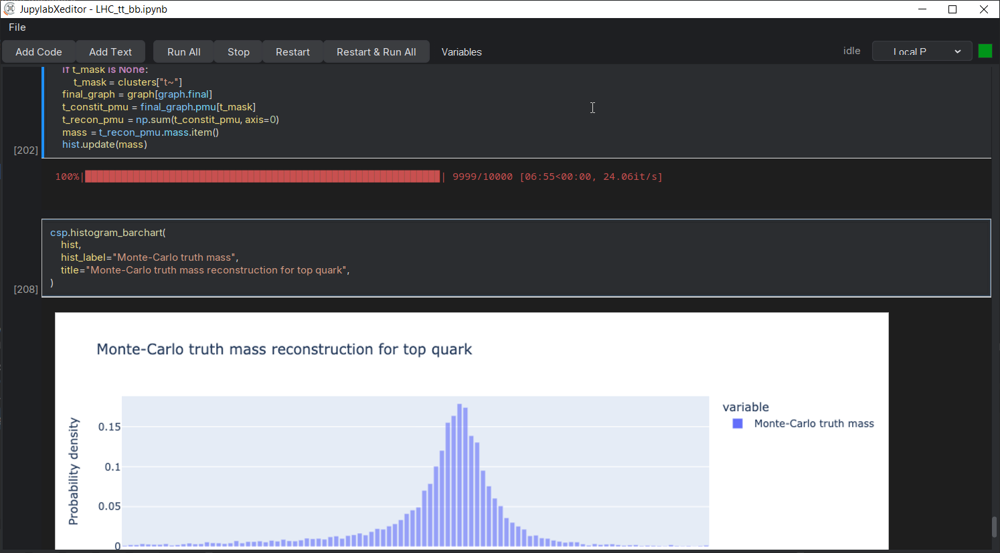

### **• Isolated and self‑contained environment**  
The application includes its own variable managers (the **Variables** tab, `:vars`), an internal code editor (**SphereCoder**, `:scode`), integrated terminals, a code vault, and a temporary workspace (`WorkSpace/`).

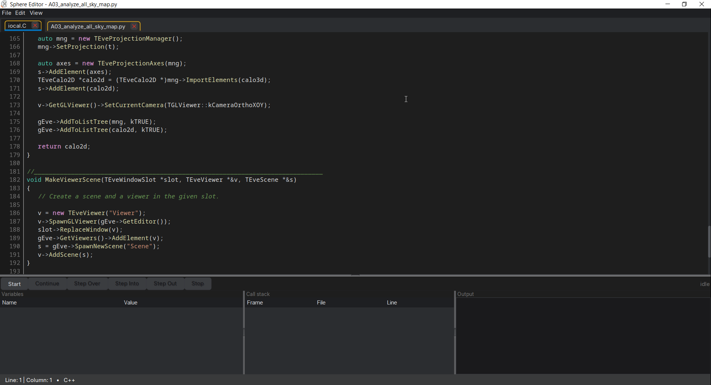

### The four-level grammar

| Form | Meaning | Example |
| --- | --- | --- |
| `:command` | An internal Sphere command | `:help`, `:fjet cluster`, `:root file open data.root` |
| `::lang …` | Run code, or a file, once in a language | `::py -O run.py 3`, `::cpp main.cpp`, `::root macro.C` |
| `[@ snippet]` | A file or snippet embedded in a line | `::py -O [@ run.py] 3` |
| anything else | Passed to the system shell, with the `PATH` Sphere resolved | `cmake --build build` |

`:help` lists the categories with the number of commands in each, `:help <category>` or `:help <word>` searches, `:help all` prints everything.

### Languages and modes

| Language | Backend | How it runs |
| --- | --- | --- |
| **C++** | `CppBackend` | One-shot compile & run, `:cpp mode`; incremental builds (`:cpp plan / build / rebuild / clean`) driven by an `#include` graph and a build cache; CMake/Ninja/Make projects (`:cpp project configure / build / clean`); toolchains g++, clang++ and MSVC detected (`CppToolchainDetector`); clangd LSP (`CppIntellisenseBackend`) |
| **Python** | `PythonBackend`, `ConsolePython` | `::py`, and `:py mode`, a persistent kernel — the same kernel the notebook editor uses |
| **Julia** | `JuliaSession` | `:julia start` keeps one interpreter alive: what a line defines stays for the next (`:julia run / vars / diag`) |
| **Fortran** | `FortranRunner` | `:fort mode` builds a program line by line, `:exec` compiles and runs it |
| **ROOT / Cling** | `RootBackend` | `::root macro.C`, `:root mode`, ACLiC (`macro.C+`), and 700+ `:root` commands |
| **JavaScript** | Node.js (`NODE_DIR`) | `:js env`, `:js diag` |
| **FastJet, fjcontrib, HepMC3, Minuit2, CLHEP** | `InProcessEngine` (inside the JVM) | `:fjet mode`, `:fjco mode`, `:hepmc mode`, `:minuit2 mode`, `:clhep mode`: every line is a command of that engine |

A line is run as soon as it forms something complete (`LineGrammar`): a statement goes at once, a loop or a function waits for its end.

### File-system commands that behave the same on every OS

`:ls`, `:cat`, `:cp`, `:mv`, `:rm` (with guards against system folders and the home directory), `:mkdir`, `:touch`, `:symlink`, `:grep`, `:find`, `:head`, `:tail` / `:tail -f`, `:wc`, `:du`, `:df`, `:tree`, `:stat`, `:sha256`, `:md5` (`--check`), `:diff`, `:which`, `:env`, `:watch`, `:cd`, `:pwd`, `:pushd`, `:popd`, `:dirs`, and `:root <file>` which lists a `.root` file's keys without ROOT. Each one is a `CommandRouter.CommandPlugin`.

### Platform commands

| Family | Commands |
| --- | --- |
| Core | `:help`, `:version`, `:quit`, `:edit`, `:scode`, `:echo`, `:set`, `:create new`, `:clear`, `:kill`, `:tasks`, `:layout`, `:clip` |
| Projects & workspace | `:project new / open / close / set / info / list / delete`, `:workspace scan / clean / diag` |
| Environments & config | `:env list / activate / deactivate / info`, `:backend list / diag / reload`, `:config show / edit / reset`, `:log level / tail / clear` |
| Python environment | `:py settings / diag / vars`, `:py doctor` (health and fixes), `:py outdated` (the newest version each package can safely take), `:py audit` (known vulnerabilities, PyPI / OSV) |
| Variables | `:vars`, `:vars diag / refresh / clear / folder / watch / unwatch / wrap / helper` |
| Plots | `:plots add / watch / unwatch / folder / clear` |
| Snippets & vault | `:snippet list / info / reload`, `:vault open / find / run / info / twins / check / stats / reindex` |
| Tools | `:tools diag / list / update` |

---

## **Modular Graphical Interface**

### **• Explorer & Editor**
- **File Explorer** (`FileExplorer`): favorites, properties, context menus per file type (open in SphereCoder, the ROOT viewer, the ROOT Lab, G4editor, the notebook editor, the image editor…)
- **Snippets** panel (`SnippetsPanel`) and the **Code Vault** (`CodeVaultPanel`): `snippets/` and `user_scripts/` searched (`:vault find TH1F #tag lang:py uses:TH1F is:twin`), checked before they run (a Python script saved as `.cc` is caught), duplicates detected, run with their last arguments
- **SphereCoder** (`SphereCoder`, `:scode [file]`), the internal editor:
  - tabs in split groups laid out on a grid (Ctrl+\, Ctrl+K V / Ctrl+K H), breadcrumbs, minimap with errors/search/changes marks
  - command palette (file, `>` command, `@` symbol, `#` symbol in any open file, `:` line)
  - syntax highlighting, outline, smart completion and hover backed by a knowledge base of ROOT, the C++ standard library, numpy, matplotlib, uproot, awkward and the whole Geant4 API
  - live linter (unclosed brackets and strings, empty Python blocks, CMake `if()` without `endif()`…), problems panel
  - debugger: C/C++ through **gdb**'s machine interface (`GdbAdapter`), Python through a **bdb** driver (`PdbAdapter`), with breakpoints, variables, call stack
  - large files (hundreds of MiB) opened read-only without loading them (`LargeFileViewer`), Markdown rendering
- **Notebook editor** for `.ipynb` files (JupyterLab format kept intact, Markdown with inline math, cells executed by the persistent Python kernel)
- **Markdown/TeX editor** (`MdTexEditor`)

### **• Monitoring & Terminal**
- C++ performance metrics (`CppMetricsPanel`): every compilation and run, *measured*, line by line (duration, peak resident memory)
- Workspace manager (`WorkspaceManager`, `WorkspacePanel`), project creator (`ProjectCreatorWindow`) with presets and a generated HEP layout (`analysis/`, `sim/geant4`, `sim/madgraph`, `sim/herwig`, `ntuples/`, `plots/`…, see `WorkSpace/EventTestGen`)
- Integrated system terminals (`TerminalManager`): CMD, PowerShell, PowerShell 7, Git Bash, WSL on Windows; bash, zsh, sh elsewhere — started interactive with the environment `settings.conf` builds

### **• Scientific Utilities**
- **Variables** tab: the variables of every language in one table — live languages are asked again, finished programs are read from the variable files they left in a watched folder (`:vars helper python|julia|cpp|fortran` writes what a language needs to publish them)
- **Plots** tab (`RootPlotsPanel`): every plot Sphere draws (restylable, kept as thumbnails) and every picture a script writes (PNG, JPG, TIFF, SVG), in any language
- **ROOT viewer** (`RootViewerPanel`) and **Sphere's TBrowser** (`SphereBrowser`, `:root browser`) with its own 3D engine
- **ROOT Lab** tab: CERN data files opened and checked, ROOT's test programs run in Java
- **Image editor** with layers, adjustments, annotations, SVG import, and a **plot digitizer** that reads numbers back out of a published figure (four reference clicks fix the axes)
- Physics calculators: `:clhep eval` (quantities with units), `:g4 material` (radiation and interaction lengths), `:lpdf`, `:fjet`, `:hepmc`…

---

---

# Geant4 in Sphere: Draw the Detector, Get the Code — and Vice Versa

Sphere treats a Geant4 geometry as **one model with two faces: the drawing and the C++**. You can draw a detector with the mouse and have it written into your `DetectorConstruction`, or type the C++ and watch the detector appear in 3D — and every change on one side is carried to the other.

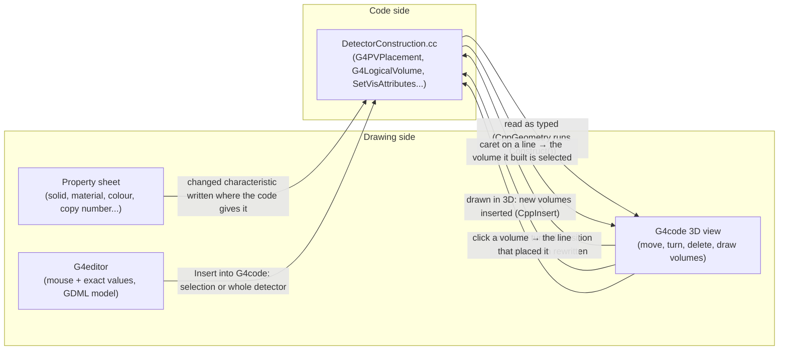

## G4editor — the geometry editor (`:g4editor [design.gdml|geometry.root]`)

A FreeCAD-style editor for Geant4 geometries. **It works without Geant4 installed.**

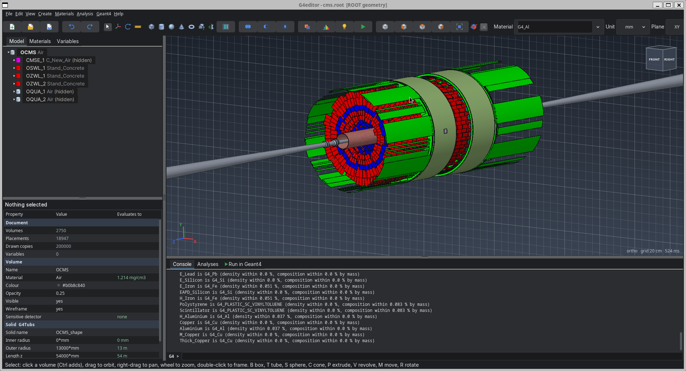

- **Draw with the mouse, type exact values**: volumes are drawn on a work plane and dimensioned from the keyboard while they are drawn. Every field accepts an expression with CLHEP units (`12`, `12cm`, `45` in an angle as `45*deg`) that may name the design's variables, so a design is parametric: change a variable and the whole detector follows.
- **Solids**: Geant4's CSG and specific solids (`G4Box`, `G4Tubs`, `G4Cons`, `G4Polycone`, `G4Polyhedra`, `G4Sphere`, `G4Torus`, `G4Trd`, `G4Para`, `G4Trap`, `G4Tet`, `G4GenericTrap`, `G4ExtrudedSolid` from a sketched polygon, `G4TessellatedSolid`, `G4ScaledSolid`), boolean solids (union, subtraction, intersection), replicas and divisions computed as Geant4's parameterisations compute them.
- **Placement**: a volume drawn in the world goes into the deepest volume that holds it entirely (`Placer`).
- **Materials**: Geant4's NIST database (107 elements and the NIST materials, as `G4NistManager` builds them) plus the design's own materials; materials that are a NIST material under another name are recognised.
- **Live analyses**: overlaps checked CAD-style while a volume is edited or dragged (`ClashWatch`, `G4PVPlacement::CheckOverlaps` sampling) with a one-click remedy; masses as `G4LogicalVolume::GetMass`; **material budget** (X/X₀ and λ/λ_I against pseudorapidity, with geantinos).
- **Design assistant** (`Advisor`): what a Geant4 expert would say, each finding with fixes that are console commands.
- **Console language** (`Script`): everything the mouse does, typed (`var T = 300um`, `box Layer …`), and **sentences in French or English** read into commands (`Intent`).
- **Templates**: calorimeter, tracker, telescope, shield, phantom, TPC — parametric, built the way Geant4's examples build them.
- **Files**: GDML (parametric, or portable), and **ROOT geometries (`TGeoManager`) read and written without ROOT**; `:g4 convert` converts in both directions.
- **3D view** in pure Java (software rasterizer: z-buffer, shading, silhouettes, translucency, section plane with capped cuts), FreeCAD navigation.
- **Insert into G4code**: the selection, or the whole detector, is written into the C++ open in G4code with everything it holds.

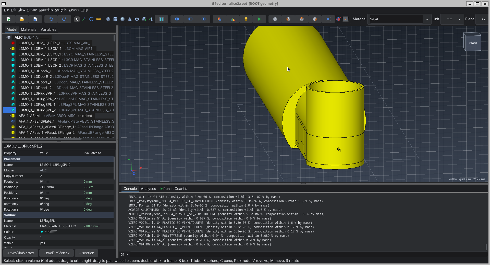

## G4code — Geant4 C++ in three columns (`:g4code [folder|file]`)

| Left | Middle | Right |
| --- | --- | --- |
| The project: files, the volumes the code builds, and **Geant4's API** (3,400 classes of Geant4 master with their documentation) | The C++, in SphereCoder's editor, with Geant4 completion and hover | The detector, in G4editor's 3D view |

**Code → drawing**
- As it is typed, `DetectorConstruction::Construct()` is run by a small interpreter of the C++ such code is written in (`CppGeometry`) and the geometry it builds is drawn.
- Overlaps are checked as `CheckOverlaps` would and marked on the `G4PVPlacement` lines; what the reading cannot know is marked too.
- The caret on a line that built something selects it in 3D.

**Drawing → code**
- A volume clicked in 3D shows the line that placed it.
- A volume **moved or turned with the mouse** has its `G4PVPlacement`'s position and rotation rewritten in the code — where the `G4ThreeVector` is initialised, or in the placement's arguments; a `G4Transform3D` is rewritten whole.
- A volume **drawn in 3D, or brought from G4editor**, is written into the code where its mother is made, with all that was given to it: solid and its expressions, material, colour, visibility, wireframe, rotation, mirror, copy number, and the volumes it holds (`CppInsert`).
- A characteristic **changed in the property sheet** is written where the code gives it: a solid's parameters in its constructor's arguments, the material in the `G4LogicalVolume`, colour/visibility/wireframe in its `SetVisAttributes`.
- Placements made **in a loop** are handled per copy: a single copy moved or deleted becomes an exception by copy number (`c == 3 ? A : …`).
- **Deleting** a volume in 3D takes its statement out of the code, with its `SetVisAttributes`, `SetSensitiveDetector`, its daughters and its solid, when nothing else names them.
- Volumes made **sensitive** (or no longer) are written in `ConstructSDandField()`.
- With no application open, a drawing is offered as a new C++ application.

**Build and run**: `:g4code new <folder> [calorimeter|tracker|telescope|shield|phantom|tpc|design.gdml]` writes a complete application (CMake, `main`, `DetectorConstruction`, actions, macros). When Geant4 is installed, it compiles and runs from the window, the compiler's errors marked in the code.

## geant4-bridge — the Geant4 engine

A C++ engine built into `geantbackend/` from sources carried in the jar. **It needs Geant4 only, never ROOT.** Sphere talks to it with JSON requests over a shared-memory channel (`G4ShmChannel`: a region mapped with the FFM API, lock-free single-producer/single-consumer rings with acquire/release ordering). From G4editor's **Run** panel: a particle gun, a number of events, a reference physics list; back come the energy deposited in every volume, the dose, and the trajectories of the first events drawn in the 3D view.

`Geant4Locator` finds installations from `GEANT4_DIR`, the environment (`Geant4_DIR`, `G4INSTALL`), `geant4-config`, conda / mamba / miniforge / pixi environments and the usual system prefixes (`:g4 locate`).

## Geant4 commands

| Command | Purpose |
| --- | --- |
| `:g4editor [file]` | Open G4editor on a GDML design or a ROOT geometry |
| `:g4code [folder\|file]`, `:g4code new <folder> [template]` | Program Geant4 in three columns; write a new application |
| `:g4 convert <in> <out>` | GDML ↔ ROOT (`TGeoManager`), without ROOT |
| `:g4 check / info / material` | Overlaps; volumes, masses and material budget; X₀ and λ_I of a material |
| `:g4 do <design.gdml> <command>` | Run a G4editor console command on a file and save it |
| `:g4 export <design.gdml> <folder>` | Write a complete Geant4 C++ application for a design |
| `:g4 bridge build\|status\|test\|stop`, `:g4 run <design> <events> [particle] [energy]` | The engine; run a design in Geant4 |
| `:g4 build <folder> [clean]`, `:g4 sim <folder> [macro.mac]` | Build a Geant4 application with CMake; run it in batch |
| `:g4 commands`, `:g4 ui /run/verbose 1`, `:g4 macro <file.mac>` | Geant4's UI commands (master) browsed, applied after a check, and macros checked against them |
| `:g4 locate`, `:g4 bib <file.bib>` | Installations found; the BibTeX of the Geant4 papers |

---

# HEP Libraries Translated to Java

These engines run **inside Sphere's JVM** (`InProcessEngine`): no executable to find, no process to start. Each one is validated against the outputs of its C++ original, with the reference data shipped in the jar.

| Library | What is translated | Validation | Commands |
| --- | --- | --- | --- |
| **FastJet** + **SISCone** | `ClusterSequence` and its strategies (N², tiled, lazy tiling, NNH, closest-pair 2D), jet areas (active, passive, Voronoi), selectors, background estimation, groomers, plugins | Arithmetic choice: `double` reproduces C++ FastJet; `dd` clusters in **double-double (106-bit)** precision; `:fjet audit` shows what double precision changes; `:fjet irc` tests IRC safety; `:fjet selftest` | `:fjet read / toy / def / cluster / jets / exclusive / area / rho / subtract / groom / nsub / ecf / lund / shapes / hist / display / export / bench / tune` |
| **fjcontrib** — 26 contribs | VariableR, ValenciaPlugin, Centauro, DISGenKt, KtClusCXX, SCJet, ClusteringVetoPlugin, DynamicR, Nsubjettiness, QCDAwarePlugin, FlavorCone, IFNPlugin, CMPPlugin, GHSAlgo, SDFPlugin, RecursiveTools, EnergyCorrelator, LundPlane, SubjetCounting, JetFFMoments, ConstituentSubtractor, SoftKiller, GenericSubtractor, JetCleanser, SignalFreeBackgroundEstimator, JetsWithoutJets | `:fjco validate`: the contribs' own example programs compared with the C++ outputs **to the character** | `:fjco list / info / cluster / obs / groom / lund / lundmap / shapes / rho / subtract / arena / flavor / rank / hist / export / bridge` |
| **HepMC3** | `GenEvent`, particles, vertices, attributes, run info, cross-section, heavy-ion and PDF info, search library, `Print` | `:hepmc validate`: HepMC3's own test programs against the C++ outputs; `:hepmc crosscheck`: every engine reads the events back, checksums compared bit for bit | `:hepmc read / write / convert` (Asciiv3, HepMC2, HEPEVT, protobuf, ROOT keys, ROOT tree, SPX, gzip; LHEF read), `listing / tree / relatives / select / filter / stats / boost / rotate / hist / dot / tofjet / bridge` |
| **CLHEP** | Units and constants, Evaluator, vectors and Lorentz vectors, geometry, matrices, random engines and distributions, GenericFunctions | Bit for bit against MinGW-w64; the random engines also against g++ on Linux (`:clhep validate`) | `:clhep eval / let / convert / units / vector / rotation / transform / random / engines / matrix / integrate / deriv / plot / ode / special` |
| **Minuit2**| Migrad, Simplex, Combined, Scan, Fumili, Hesse, Minos, contours, parameter transformations | Bit for bit against the C++ on Windows (MinGW) and Linux (g++), including the x87 `long double` (`sphere_x87.S`, `:minuit2 x87`); `:minuit2 validate` | `:minuit2 minimize / fit / hesse / minos / profile / contour / scan / noise / selftest / parallel`; `:root minuit2 crosscheck` compares with ROOT's C++ Minuit2 |
| **TMinuit** | MINUIT's command language and its plots | `:minuit validate` against ROOT's TMinuit outputs (Windows and Linux) | `:minuit fit / cmd / contour / plot / compare` (TMinuit vs Minuit2 side by side) |
| **LHAPDF**| Sets, members, grids and interpolation, `alpha_s`, Hessian / replica uncertainties, correlations | `:bridge crosscheck`: every engine against Java on the same points; `:root pdf alphas-match` answers exactly what LHAPDF would | `:lpdf list / search / install / show / mkpdf / xfxq / alphasq / uncertainty / correlation / table / reweight`; `:root pdf …` (bands, sum rules, luminosities, seams, plots) |

Minuit2, TMinuit and `TMath` reproduce the C++'s bits by calling the machine's C library through the FFM API. The JDK allows this only when granted: the build writes `Enable-Native-Access: ALL-UNNAMED` into the jar manifest. Without it, Sphere says at startup that the fits are not the C++'s bits.

---

# ROOT Without ROOT: the Java Reader, Writer and Viewer

Sphere opens, inspects, plots, fits and writes `.root` files **without a ROOT installation**.

- **Reading** (`com.sphere.core.rootio`): the header, `TKey` records and directories, the `TStreamerInfo` class descriptions, any object streamed member by member, and `TTree` branches read from their baskets.
- **Writing**: `TFile` and `TTree` written record by record as ROOT writes them (files written as ROOT 6.20/04); records copied, renamed, dropped or extracted without touching their bytes (`RootWriter`).
- **Decompression in pure Java**: ZLIB, LZ4, **Zstandard** (ROOT's default since 6.20) and **XZ/LZMA**.
- **Remote and archived files**: `http(s)://` read with range requests (only the bytes asked for travel), `root://` EOS URLs tried over HTTPS, members of zip archives (`multi.zip#Event.root`), `file.root/T` tree suffixes.
- **Viewer** (`RootViewerPanel`): pads painted the way ROOT paints them (`RootPadPainter`), LEGO/SURF/BOX/SCAT and `TGraph2D` in a 3D view that can be turned, `TLatex` titles, the **Fit Panel** (chi² or Poisson likelihood, minimized by Sphere's bit-exact Minuit2), `TFormula`, ROOT's smoothing/peak-search algorithms carried over line for line, export of a canvas as the `.C` macro that draws it again, and any context-menu function Sphere does not do itself handed to ROOT when the engine runs (`RootEngineCall`).
- **Sphere's TBrowser** (`:root browser`): demos' canvases live in 3D, pictures, and fits by Levenberg–Marquardt to the shapes of the trade (Gaussian on a polynomial, Breit–Wigner, Crystal Ball, Voigt, Landau, Tsallis, erf turn-on…), rendered by Sphere's own z-buffer 3D engine — no OpenGL, so it runs over a remote desktop or WSL.

## ROOT Lab (`:rootlab`)

| Command | Purpose |
| --- | --- |
| `:rootlab test [suite ...] [--network]` | ROOT's test programs, ported to Java, run against their reference files. Suites: archive, compression, histogram viewer, integrity, random (`TRandom`, `TRandom2`, `TRandom3`), stressHistogram, stressIOPlugins, stressLinear |
| `:rootlab open <file\|folder\|url>` | Open in the ROOT Lab tab — from disk, a URL (CERN Open Data, root.cern) or a zip archive |
| `:rootlab fsck <file\|url> [--deep]` | A file-system check for ROOT files: every record, checksum and directory checked against the rest |
| `:rootlab compare <a> <b>` | Two files histogram by histogram (`Chi2Test`, Kolmogorov), as release validation is done at the LHC |
| `:rootlab stats <file\|url> <tree> <branch>` | Statistics of a branch in one pass (Welford), local or remote |
| `:rootlab sniff <file>` | What a data file is, by its content: ROOT (and RNTuple), HepMC, LHE, YODA, SLHA… |

---

# The ROOT Engine and the `:root` Commands

When ROOT is installed (`ROOT_DIR`), Sphere builds and drives **root-bridge** and more than **700 `:root` commands** reach it:

| Area | Examples |
| --- | --- |
| Engine | `:root ping / version / sys uptime / sys config`, `:root mode`, `:root script load / run / compile` (ACLiC) |
| Files & directories | `:root file open / open-remote / ls / cd / get / mkdir / copy / move / delete / scan`, `:root xrootd open / ls / copy / exists` |
| Trees & frames | `:root tree attach / column / plot / stats / filter`, `:root chain new / add / entries`, `:root rdf open / filter / count`, `:root schema discover`, RNTuple writing, `TTreeReader` and selector generators, named cuts (`:root cut new / and / or / not / apply`) |
| Histograms, graphs, functions, fits | Histogram, `TF1`, graph and canvas commands; fits read back; styles |
| Advanced modules | RooFit / RooStats, TMVA (applying a model), sparse histograms, splines, density estimation, PCA, unfolding, decompositions, integrators, FFT, GenVector, geometry, SQL, PROOF/distributed, XML, compression |
| Your own pipelines | Shared libraries in `includes/` and macros in `user_scripts/`, global then per project: `:root includes build / load / reload`, `:root build`, the pipeline builder (`:root personal pipeline`, `:root pipeline new / build / load / run / time / watch / check / scan / drop`) |
| Parton distributions | `:root pdf open / use / info / check / value / band / sumrules / scan / lumi / compare / graph / plot / fetch / install` |
| Toolchain environment | `:root env detect / write / show`: what MadGraph, Herwig, Rivet or a Geant4 build need to find the same ROOT and PDF folders |
| Demos & tutorials | `:root demo [list\|all]`, `:root tutorials`, `:root canvas formats` — every canvas reaches the Plots tab |
| Diagnostics | Debug, profiling and watchdog commands of the bridge |

Without the engine, `:root tree attach` and the tree commands fall back to Sphere's own Java reader.

---

# The Bridge: SPX, One File Every Engine Reads

**SPX (Sphere Physics eXchange)** is a little-endian binary file (`"SPHRSPX1"` header, a directory of named sections of `float64`, `int64` or text) laid out so that it needs no parsing: Julia wraps it with `Mmap`, C++ maps it, Python hands it to numpy, Fortran reads it with stream access — and all of them see **the bits Java wrote**, not a decimal rendering of them. Kinds: PDF sets, event samples (HepMC3 events included), tables.

| Reader (written by `:bridge libs`) | Language |
| --- | --- |
| `sphere_spx.hpp`, `sphere_view.hpp`, `sphere_view3d.hpp` | C++ / ROOT |
| `SphereSPX.jl` | Julia |
| `sphere_spx.f90`, `sphere_lhaglue.f90` (LHAPDF's Fortran interface: `InitPDFsetByName`, `evolvePDF`) | Fortran |
| `sphere_spx.py`, `sphere_mpl.py` | Python |
| `sphere_minuit2.hpp`, `sphere_autopilot.hpp`, `sphere_x87.S` | Minuit2 helpers for C++ |

- `:bridge pdf <handle>`, `:bridge events`, `:hepmc bridge`, `:fjco bridge`: hand PDFs, events, jets or observable tables to every engine.
- **The way back**: anything an engine publishes (`spx::publish`) lands in the Plots tab by itself (`:bridge outbox`), and `:minuit2 fit` can fit a histogram published by a C++/ROOT macro, Python, Julia or Fortran.
- `:bridge crosscheck`: every engine against Java on the same PDF points — bits and speed.

---

### **• Safe diagnostics**  
It provides telemetry tools (`CppMetricsPanel`) and startup diagnostics to evaluate memory performance or physics computations live.

---

## **Important Distinction**

Unlike a security sandbox (which isolates a program to prevent access to the system), **Sphere is a development and analysis sandbox**—similar to a Jupyter Notebook or an enhanced MATLAB/ROOT console.

It has direct access to hardware, native storage, and processors to deliver maximum performance.

**Sphere is a scientific desktop platform (IDE / Workbench) dedicated to High Energy Physics (HEP).**  
Developed in **Java/Swing** with a modern dark theme, it serves as an execution environment, diagnostic tool, and interactive control interface.

---

# **Architecture & Key Features**

## **Polyglot Execution Engine (Multi‑Mode)**  
An interactive CLI with autocompletion (global TAB interception) and command history (Ctrl+R, arrow keys) allows dynamic switching between multiple languages and environments (C++, Python, Julia, etc.).

---

## **Native C++ Backend & CERN ROOT Integration**  
Sphere embeds a highly optimized C++ backend (`CppBackend`, `CppDiagnosticsEngine`) and communicates with CERN ROOT through a native bridge (`RootBackend` / `RootBridgeCompiler`).

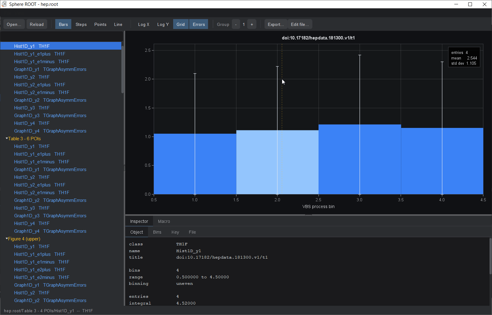

---

## **Modular Graphical Interface**

### **• Explorer & Editor**  
- File manager (`FileExplorer`)  
- Code panel (`Snippets`)  
- Internal editor (`QuickCodeEditorFrame`)

### **• Monitoring & Terminal**  
- C++ performance metrics (`CppMetricsPanel`)  
- Workspace manager (`Workspace`)  
- Integrated system terminals (Bash, CMD)

### **• Scientific Utilities**  
- Variable inspection panels  
- Physics calculation tools  
- Graphical visualization modules (`Plots`)
- etc...

---

## **Robustness & Performance**

- Asynchronous execution (`CompletableFuture`) to keep the GUI responsive  
- Telemetry tracking  
- Startup diagnostics (`StartupDiagnostic`)  
- Automated resource cleanup via shutdown hooks


## High-Performance Cross-Platform Hybrid Architecture & Native Java Interoperability

## ROOT Data Integration Layer

The **root-bridge** is a high-performance C++20 subsystem that acts as an ultra-low latency, zero-copy data and rendering gatekeeper between raw ROOT storage (`.root` files, `TTree`, `RNTuple`, `TChain`) and modern runtime clients (Java 22+, Python, Julia, PyTorch, TensorFlow, C++ applications).

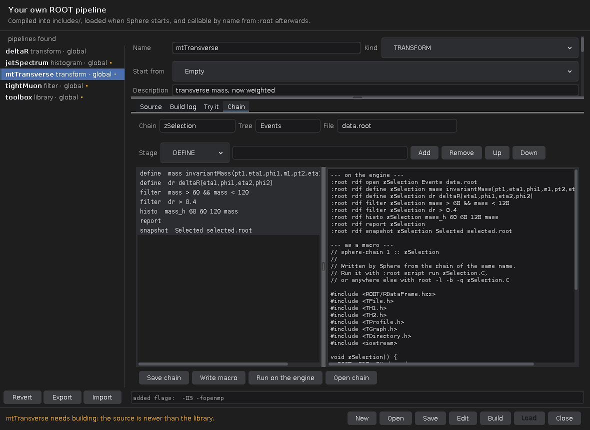

It is optimized for:

- Ultra-low latency inter-process communication (IPC)
- High-throughput asynchronous file ingestion across multi-partition datasets
- Zero-allocation CERN ROOT / RNTuple telemetry processing

It integrates all sub-systems, including the **Multi-File/Multi-Partition Ingestion Engine** (`TChain` / `RNTuple` dataset partitions) and the **`io_uring` Fixed Files / Fixed Buffers Zero-Overhead Kernel Layer**, while remaining **fully cross-platform (Linux, WSL2, macOS, Windows)**.

It dynamically pairs OS-native asynchronous I/O engines with ring-buffered shared memory (SHM), dynamic SIMD acceleration, and the **Java 22+ Foreign Function & Memory (FFM) API (Project Panama)** to achieve end-to-end zero-copy data transfers with **zero external JARs or heavy third-party dependencies**.

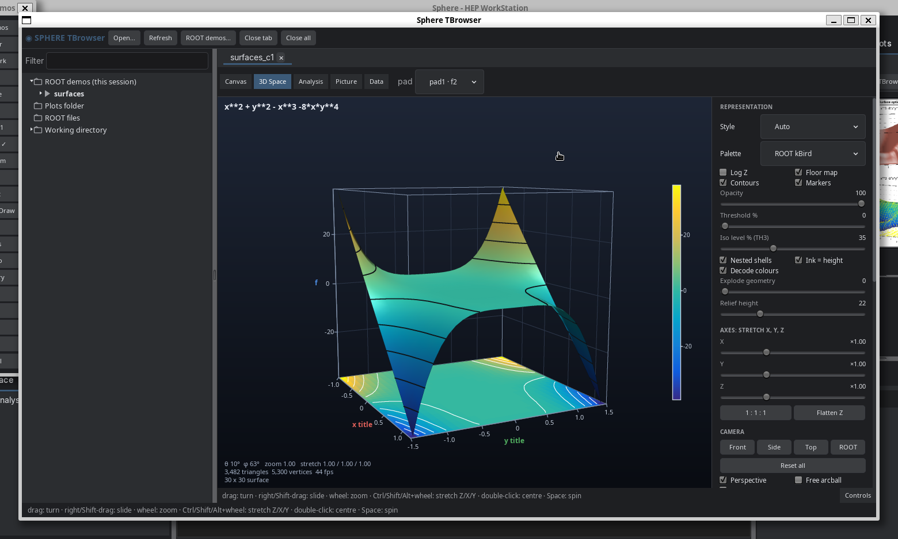

---

## Key Design Principles

1. **Cross-Platform OS-Native Async I/O Layer**
   - **Linux & WSL2:** `io_uring` with kernel-thread polling (`SQPOLL`) and registered fixed buffers.
   - **Windows:** Win32 I/O Completion Ports (IOCP) with asynchronous overlapped I/O.
   - **macOS:** `kqueue` / POSIX Async I/O (`aio`) engine.

2. **True End-to-End Zero-Copy Data Pipeline**
   - OS async disk ingestion writes directly into pinned SHM regions (`mmap` / `MapViewOfFile`).
   - Downstream runtimes consume raw buffers directly (`torch::from_blob` in C++, `MemorySegment.ofAddress` via the Java FFM API).

3. **Zero-External-Dependency Core**
   - **C++ side:** Pure C++20 + OS-native APIs (`liburing` on Linux, Win32 API on Windows, POSIX/Darwin on macOS).
   - **Java side:** Standard Java 22+ JDK core (`java.lang.foreign.*` for off-heap SHM access, `java.awt`/Swing `BufferedImage` for native rendering).

4. **Hybrid Command & Rendering Paradigm**
   - **High-throughput data:** binary table/column streaming via SHM rings.
   - **Graphics & visualization (`TCanvas`):** off-screen batch rendering in C++ mapped directly to ARGB pixel buffers in SHM.
   - **Dynamic execution:** JIT invocation via ROOT's native CINT/Cling interpreter (`gROOT->ProcessLine()`).

---

## 1. Shared Memory & IPC Engine

- **Fixed Contiguous SHM Layout:** Packs the `RingHeader`, payload slots, and high-precision TSC telemetry side-buffers into a single, pre-allocated shared memory region (`ShmRegion`).
- **Lock-Free SPSC Mechanics:** Uses atomic memory orderings (`acquire`/`release`) to pass messages safely between threads without mutex locks.
- **Virtual Loop Memory Mirroring:** Doubles address-space mapping via OS virtual memory (`mmap`/`MapViewOfFile`) to eliminate wrap-around boundary checks during continuous reads and writes.
- **Hardware TSC Telemetry:** Captures native CPU cycle timestamps (`rdtsc`/`cntvct_el0`) with configurable sub-sampling masks to monitor per-slot processing latency.
- **Zero-Copy I/O Vectoring:** Leverages OS-native vector I/O (`writev`/`readv`) to send and receive structured frame batches directly from socket buffers.
- **Multi-Client Isolation (`MultiProducerRingSet`):** Uses a partitioned single-producer design with fair round-robin polling to prevent thread contention across multiple clients.
- **Resource Guardrails:** Implements watermark triggers, drop policies, and strict capacity checks to protect shared memory boundaries under high load.

---

## 2. Runtime SIMD & Low-Level Primitives

- **Cross-Architecture Vectorization Layer:** Implements multiple ISA-specialized execution paths (**Scalar**, **SSE4.2**, **AVX2**, **AVX-512/VL/VNNI**, **ARM NEON**, **SVE**, **SME**) with dynamic runtime detection for maximum per-cycle throughput.
- **Vectorized String Primitives:** Accelerates core operations — `trim`, `starts_with`, `ends_with`, ASCII case conversions — using 128/256/512-bit registers to eliminate branch divergence.
- **SWAR-Optimized Hashing:** A low-latency FNV-1a hashing algorithm designed for streaming workloads with minimal instruction dependency chains.
- **HPC Synchronization Primitives:** Exposes high-resolution cycle counters, CPU relax hints (`_mm_pause` / `isb`), and cache-alignment helpers to eliminate false sharing in lock-free pipelines under strict NUMA constraints.

---

## 3. High-Throughput Async I/O & Decompression Engine

### A. Kernel Zero-Overhead Integration (Linux `io_uring` Fixed Resources)

- **Registered Fixed Buffers (`io_uring_register_buffers`):** Pre-pins the entire `ShmRegion` memory range in the Linux kernel (`pin_user_pages()`), bypassing page-table walks (`get_user_pages`) and page locking during DMA transfers.
- **Registered Fixed Files (`io_uring_register_files`):** Pre-registers file descriptor arrays inside kernel structures, replacing global file-table lookups (`fget`/`fput`) with zero-lock direct array indexing (`IOSQE_FIXED_FILE`).
- **SQPOLL Mode:** Utilizes kernel-thread polling (`IORING_SETUP_SQPOLL`) for non-blocking submission rings, eliminating syscall overhead (`io_uring_enter`) during peak ingestion.

### B. Multi-File & Multi-Partition Ingestion (`RootBatchLoaderMultiFile`)

- **`TChain` & Partitioned `RNTuple` Support:** Seamlessly scans, maps, and ingests datasets spanning multiple files or disk partitions via unified physical index tracking (`file_index`).
- **Partition-Aware Request Coalescing:** Merges adjacent small page/basket requests into single physical read chunks, while strictly preventing coalescing across partition boundaries.
- **Physical Seek Optimization:** Sorts multi-file requests using composite keys `(file_index, file_offset)` to maximize sequential I/O throughput and minimize controller head movement.
- **Media-Aware Dynamic Tuning:** Scales gap-merging thresholds (`max_gap_bytes`, `max_read_bytes`) dynamically based on storage characteristics (**NVMe SSD**, **SATA SSD**, or **HDD**).

### C. Parallel Decompression Pool

- **Multi-Format Worker Pool:** A lock-free, task-based `std::jthread` worker queue provides parallel decompression across **LZ4**, **ZSTD**, and **ZLIB/DEFLATE** (via `libdeflate` with `thread_local` state reuse).
- **Sequential Restoration:** Tracks logical indexing (`logical_index`) across out-of-order disk completions, guaranteeing strictly ordered payload delivery to downstream execution units.

---

## 4. Cross-Platform Async I/O Strategy

Each OS exposes its own ultra-performant kernel-level asynchronous I/O mechanism. The backend abstracts over these behind a common I/O interface:

| Operating System | Native Async I/O API | Native SHM Mechanism |
| --- | --- | --- |
| **Linux (native)** | `io_uring` (SQPOLL, Fixed Buffers) | `shm_open` + `mmap` |
| **WSL2** | `io_uring` (supported natively on recent WSL2 Linux kernels) | `shm_open` + `mmap` |
| **Windows (Win32/MSVC)** | IOCP (I/O Completion Ports) / `GetQueuedCompletionStatusEx` | `CreateFileMapping` + `MapViewOfFile` |
| **macOS (Darwin)** | `kqueue` / POSIX AIO (`aio_read`/`aio_write`) | `shm_open` + `mmap` |

---

## 5. End-to-End Hybrid Topology (Cross-Platform)

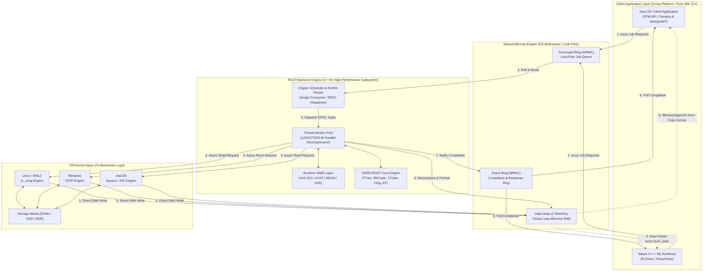

### Detailed Queueing Architecture (Linux Reference Implementation)

The diagram above abstracts the queueing layer; the following expands the **Hybrid Queueing Architecture** in full detail for the Linux/`io_uring` reference implementation:

```
+-----------------------------------------------------------------------+
|                       Clients / External Producers                    |
|                (Process 1, Process 2, PyTorch/TF Clients)             |
+-----------------------------------+-----------------------------------+
                                    |
      1. Allocates Tensor Payload   |   2. Pushes Job Request
                  v                 v
+-----------------------------------+-----------------------------------+
|                        SHARED MEMORY (SHM)                            |
|                                                                       |
|  +-----------------------------------------------------------------+  |
|  | DATA HEAP: Zero-Copy Tensors (Raw memory buffers, Chunks)       |  |
|  +-----------------------------------------------------------------+  |
|                                                                       |
|  +-----------------------------------------------------------------+  |
|  | COMMAND RING (MPMC Lock-Free Queue): Concurrent client pushes   |  |
|  +-----------------------------------------------------------------+  |
+-----------------------------------+-----------------------------------+
                                    |
                                    v
+-----------------------------------+-----------------------------------+
|                        ENGINE SCHEDULER                               |
|   (Single Consumer of MPMC / Polling Thread / NUMA-Aware Router)      |
+--------+--------------------------+--------------------------+--------+
         |                          |                          |
         | 3. Dispatches Task       | 3. Dispatches Task       | 3. Dispatches Task
         v (SPSC Queue 1)           v (SPSC Queue 2)           v (SPSC Queue N)
+--------+-------+         +--------+-------+         +--------+-------+
|  Worker Queue  |         |  Worker Queue  |         |  Worker Queue  |
|  (SPSC Ring 1) |         |  (SPSC Ring 2) |         |  (SPSC Ring N) |
+--------+-------+         +--------+-------+         +--------+-------+
         |                          |                          |
         v                          v                          v
+--------+-------+         +--------+-------+         +--------+-------+
|    WORKER 1    |         |    WORKER 2    |         |    WORKER N    |
| (Core/NUMA Pinned)|      | (Core/NUMA Pinned)|      | (Core/NUMA Pinned)|
+--------+-------+         +--------+-------+         +--------+-------+
         |                          |                          |
         +--------------------------+--------------------------+
                                    |
            4. Resolves SHM Chunk Offset to Raw Pointer (Zero-Copy)
                                    v
+-----------------------------------+-----------------------------------+
|                      ML INFERENCE FRAMEWORKS                          |
|                                                                       |
|  * PyTorch C++ API    --> torch::from_blob(raw_ptr, shape, dtype)     |
|  * TensorFlow C API   --> TF_NewTensor(..., raw_ptr, ...)             |
+-----------------------------------+-----------------------------------+
                                    |
            5. Ingestion & Computation (Zero Data Duplication)
                                    v
+-----------------------------------+-----------------------------------+
|                        EVENT RING (MPMC)                              |
|          (Worker writes response / Client polls completion)           |
+-----------------------------------------------------------------------+
```

---

## 6. Key Architectural Highlights

- **Hybrid Queueing Architecture**
  - **MPMC front-end:** enables multiple clients to safely enqueue requests completely lock-free (Multi-Producer Multi-Consumer).
  - **SPSC back-end:** the Scheduler dequeues tasks from the global MPMC queue and routes each payload to a private Single-Producer Single-Consumer (SPSC) queue dedicated to a specific worker, entirely eliminating CPU cache bounces and thread contention among execution workers.

- **Coalesced Multi-Partition Ingestion Pipeline:** Integrates `RootBatchLoaderMultiFile` with kernel-level non-blocking async reads (`AsyncFileLoaderIoUring`) using `submit_batch_fixed` to fetch coalesced disk chunks directly into pre-pinned zero-copy SHM arrays.

- **Parallel Decompression Pipeline:** Automatically parses 9-byte ROOT headers (`"L4"`, `"ZS"`, `"ZL"`), routing payloads across worker threads via `DecompressorPool` before exposing raw memory buffers to downstream compute runtimes.

- **Zero-Copy Framework Binding:**
  - **PyTorch** consumes the raw, decompressed buffer directly via `torch::from_blob()`.
  - **TensorFlow** consumes the raw buffer via `TF_NewTensor()`.

---

## 7. Summary Matrix: OS & Runtime Responsibilities

| Subsystem / OS | Target OS | Primary Async I/O API | Memory Mapping API |
| --- | --- | --- | --- |
| **Linux Engine** | Ubuntu, RHEL, Arch | `io_uring` (SQPOLL, Fixed Buffers) | `mmap` / `shm_open` |
| **WSL2 Engine** | Windows Subsystem for Linux | `io_uring` (via WSL2 Linux kernel) | `mmap` / `shm_open` |
| **Windows Engine** | Windows 10 / 11 / Server | Win32 IOCP (`GetQueuedCompletionStatusEx`) | `CreateFileMapping` / `MapViewOfFile` |
| **macOS Engine** | macOS (Intel & Apple Silicon) | `kqueue` / POSIX `aio_read` | `mmap` / `shm_open` |
| **Java Client** | Cross-platform (JDK 22+) | FFM API (`java.lang.foreign.*`) | `MemorySegment.ofAddress` |

---

## 8. Environment Setup Adjustments
Remove the .windows or .linux extension corresponding to the operating system you are using.
Then edit settings.conf and update the PATH entries.

## 9. Installation

### Linux: `liburing` development package

```bash
# Ubuntu/Debian
sudo apt-get install liburing-dev
sudo apt-get install libnuma-dev

# Fedora/RHEL/AlmaLinux
sudo dnf install liburing-devel
sudo dnf install numactl-devel

# Arch Linux
sudo pacman -S liburing numactl
```
## 11. Citing the Software Sphere Uses

The console's **Citations** menu shows the references each library asks its users to cite, and every family writes them as BibTeX: `:g4 bib`, `:fjco bib`, `:hepmc bib`, `:clhep bib`, `:minuit2 bib` (`:fjet version` and `:lpdf version` point to the same menu). Please cite Geant4, ROOT, FastJet, fjcontrib, HepMC3, CLHEP, Minuit and LHAPDF when results obtained with Sphere rely on them.
